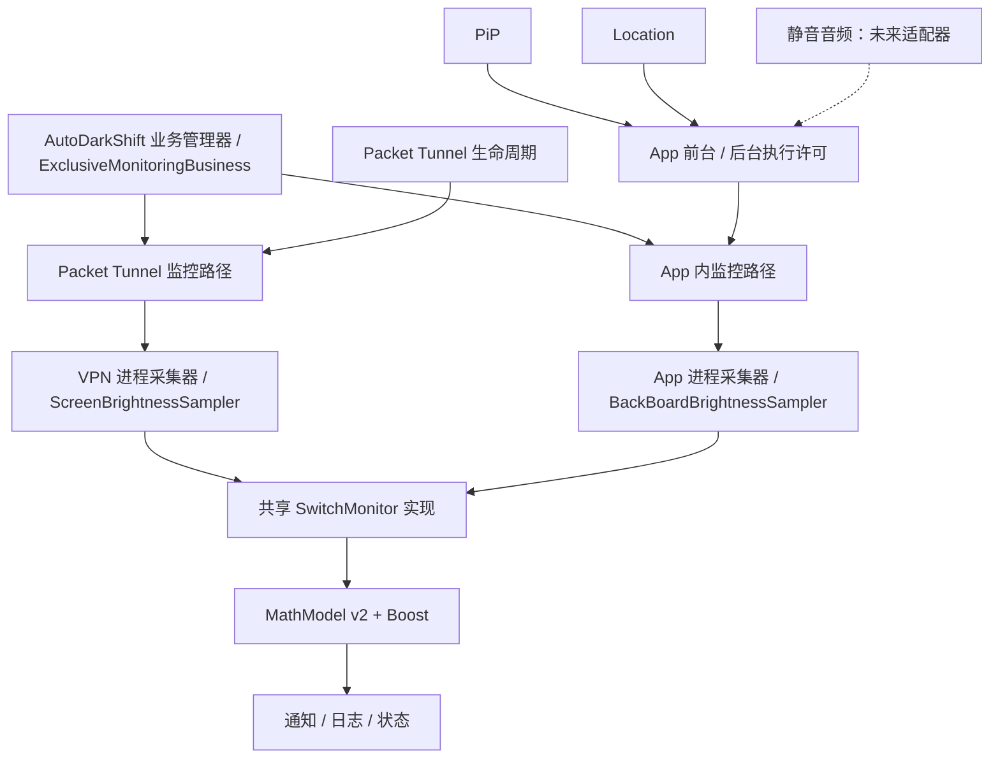

# 保活与切换监听的架构边界（1.1.0）

1.1.0 将监听固定为两条互斥路径：Packet Tunnel 在扩展进程使用原事件加动态轮询，App 内监控在主进程只轮询 `BKSDisplayBrightnessGetCurrent`。VPN、PiP、Location 是独立保活能力，可以同时开启；业务选择不会按 VPN 状态自动迁移进程。`silentAudio` 仅为枚举预留，没有注册服务、GUI 或实际音频播放。平台细节见 [KEEP_ALIVE.md](KEEP_ALIVE.md)，App 输入见 [BACKBOARD_MONITORING.md](BACKBOARD_MONITORING.md)。

## 开发者界面与记录策略（build 3）

`AppPreferences` 是主 App 的界面偏好层，仅持久化开发者模式，默认关闭，不进入数学模型、Packet Tunnel 或保活接口。`ControlView` 只创建一份偏好对象，信息页切换后仪表立即响应。仪表固定先显示监听方式，再显示当前状态；普通模式仅此两区，开发者模式才增加平级的“高级功能”（切换监听 / 通知与统计）及操作反馈。

日志记录是独立运行配置 `MonitorConfiguration.runtimeLoggingEnabled`，默认关闭，旧配置缺少该字段也关闭。开发者模式开关不改变监听、保活或此前明确选择的日志状态。记录开关统一控制 App / Provider 诊断、运行 JSONL、Boost 及自动 Provider 缓存；配置随既有 profile / IPC 应用到两个进程。仅改日志开关的 reload 不重新安装采样、重置趋势或取消在途通知。关闭后既有文件保留可读，未落盘 Boost 缓冲丢弃，已有开放记录导出为不完整 trace；重新开启只记录之后的输入，不补造停记时段。

快照、计数与成功通知历史是监控状态，仍按原规则保存。关闭记录不影响模型、通知或 GUI 状态读取；手动导出可以只读取得扩展历史并直接生成分享文件，不重新开启记录或保存新的 Provider 日志缓存。

`NotificationAuthorizationService` 独立处理通知授权：首次处于 notDetermined 时申请 provisional 临时授权，前台与本地通知声音策略也保持安静；已有 authorized / denied 等设置不自动改写。高级页面中的主动请求才申请正式授权。系统授权、通知接受、实际展示和快捷指令执行继续分别评价。

## 依赖关系

| 层 | 文件 / 接口 | 职责 |
| --- | --- | --- |
| GUI | `ControlView`、`DashboardView`、`KeepAliveView` | 底部 Tab、互斥业务选择、独立保活与真实平台状态 |
| 通用保活 | `KeepAliveService`、`KeepAliveManager`、`KeepAliveSwitchControl` | Foundation 抽象，管理注册与独立生命周期，不依赖模型或监听存储 |
| 业务管理 | `ExclusiveMonitoringBusiness` | 先持久化关闭两路，停止采样并等待已提交通知结算，再启用目标路径 |
| 固定进程 | `MonitoringHostCoordinator` | 必须显式传入 `.packetTunnel` 或 `.app`；处理各自配置、运行与导出 |
| 生产组合 | `AppComposition`、`PacketTunnelProvider` | 主 App 只创建 BackBoard 纯轮询采样器；扩展只创建原采样器 |
| 共用业务 | `SwitchMonitor`、MathModel v2、`BoostTraceRecorder` | 趋势、冷却、去重、通知及独立运行 / Boost 日志 |
| 跨进程控制 | `MonitoringClient`、`MonitorControlEndpoint` | 配置确认、身份匹配、快照和两路日志；保留协议版本 3 |

## 固定进程与严格互斥

Packet Tunnel 路径在 VPN 未连接时保存启用选择并等待连接，不能创建 App 采样器作为 fallback。连接后扩展应用该选择；断开后仍选择该路径并等待，不自动改成 App 内监控。VPN 正在启动、重连、断开或状态未知时，不能把未取得回复当作已停止。

App 路径始终使用 `BackBoardBrightnessSampler`，最低 iOS 17，按 v2 模型启用 1 / 10 / 30 / 60 / 120 Hz 动态纯轮询。getter 在选择 App 时才 lazy 加载并预检；无符号明确失败，不造样本或心跳、不回退 UIScreen，诊断也不读取 UIKit 对照。PacketTunnel 不加载 BackBoard，继续 UIScreen 事件加轮询。VPN 的连接与断开不改变该进程或采样方式；即使 VPN 保活继续，选择 App 路径后扩展监听也须保持禁用。两条路径复用同一 v2 模型及 Boost 实现，各自保存配置、快照、成功历史和双日志。

`ExclusiveMonitoringBusiness` 串行切换，先保存两路关闭配置，再确认没有采样和未结算的系统通知，最后保存并应用目标配置。未提交候选按生命周期取消；已调用系统通知接口的请求必须等待实际终态并保存历史。回复未知或停止超时则不启用目标。保存关闭意图不能证明未知运行已停用。旧配置两路均启用时优先保留 App 选择，先持久关闭 Packet Tunnel，再执行同样的交接。

PiP 和 Location 的实际 active / reasserting 状态只授予 App 后台执行许可，与 VPN 状态无关。前台允许 App 路径执行；后台没有已确认 App 保活则 sleep，取消轮询并清空心跳，恢复许可后 wake 并从新基线开始。`.inactive` 保留此前许可，只有 `.background` 撤销前台许可。PiP 与 Location 同开仍只运行一个 BackBoard 监听实例。关闭监听不会关闭任一保活服务。

当前频率、亮度与 S 来自真实监听快照；两条路径均报告实际轮询频率。外观来自 App 可见的系统 ColorScheme，通知目标或成功历史不能证明其他 App 的实际外观。页面刷新和查询不生成样本或心跳。

## 历史：App 轮询调度诊断（1.0.x build 17）

本节保留旧 App 事件加轮询路径的实现与诊断依据；1.1.0 / build 2 的 App 路径重新使用 DispatchPollingScheduler 等待，但读取源改为 BackBoard，不注册 UIKit 亮度观察者。

`didStart` 的实际 active 经 KeepAliveManager 回调到 AppController，再由宿主协调器按真实 runtime phase 唤醒同一个 SwitchMonitor。重复许可也能修正仍 sleeping 的实例；在途宿主交接完成后重新应用当前许可。`.inactive` 保留此前前后台许可，只有 `.background` 撤销前台许可，避免控制中心或 PiP 启动动画造成不必要的观测重置；UI 刷新在 active 场景恢复。

采样器只管理亮度观察者与 MainActor 读取，独立 PollingScheduler 管理等待。App 显式注入 DispatchPollingScheduler，VPN 使用默认 MainRunLoopPollingScheduler。Dispatch 队列不访问 UIKit，只投递至多一个待处理的 MainActor 读取；停止、变频和重新安装用 generation 拒绝旧 tick，不补发错过的读数。释放时取消 source / Timer 与亮度观察者。该调度器复用于任意获得 App 执行许可的保活方案，该 build 17 调度改动不涉及 Location 或增加音频方案。

最新 build 16 日志显示 PiP 实际 active 后仍有 poll，最后心跳也更新；不能据此认定旧 Timer 已停止。Dispatch 调整用于去除轮询等待对主 RunLoop 的依赖，并分开观测 worker tick 与 MainActor 读数。后台执行仍取决于系统调度；该 timer 本身不提供保活资格。底层模型与 Boost 算法不变。

七个链路事件与通知诊断的判读顺序见 [DEVICE_ACCEPTANCE.md](DEVICE_ACCEPTANCE.md) 第 13 节。心跳只由 SwitchMonitor 接受的真实读取更新；状态查询、调度 tick 和页面刷新均不产生心跳。

## 存储与跨进程控制

App 组合入口先探测共享目录的打开与读写，选择一种模式并写入 VPN 元数据；Provider 严格使用该选择。模式和协议版本纳入握手，旧配置在停止状态下保存/重载后迁移。

| 模式 | 持久化与同步 |
| --- | --- |
| `app-group-v1` | 共用 App Group；App 保存配置，扩展保存运行快照、成功历史和监听日志；消息确认实际应用版本 |
| `local-ipc-v1` | AppRuntime / ProviderRuntime 分别位于各自私有容器；启动参数携带配置，运行时消息携带完整配置；App 缓存扩展返回的原始快照 |

生产 App 监听的配置、快照、历史及双日志位于私有 `BackBoardMonitoring` 目录，复用 1.0.3 / build 2 已有配置和成功历史；默认关闭，只有该目录原本已启用才恢复。不迁移旧消息业务启用值。旧 `MessageMonitoring` 和 `LocalMonitoring` 只读导出历史运行与 Boost，不创建采样实例；历史 scope 不代表当前仍在该目录运行。Provider 日志与 App 日志分别保留，导出汇合对应流并保留来源和原始时间，不覆盖旧缓存。

本地模式下，配置消息必须带有效参数及匹配 revision。扩展的成功历史保存在 ProviderRuntime，系统重新拉起不会被主 App 的旧历史覆盖。由 App 开启时携带最新保存参数及已获取的成功历史，Provider 只接受更新的历史；每次路径选择先成功读取 VPN 配置，并将最新配置持久化到同一扩展所有 profile 的 `initialConfiguration`；读取或任一保存失败时阻止启动目标路径，避免把读取失败当作没有 VPN。系统重新拉起时优先应用启动参数或 profile 中该配置，防止 Provider 私有目录中的旧启用值恢复被关闭的路径。完成通知的历史仍保存在 ProviderRuntime，不由旧主 App 历史覆盖。

查询不刷新采样心跳。App 停止连接后清除通信确认，本地缓存只代表上次获得的状态；不能直接访问扩展的私有文件。运行与 Boost 日志分别建立分页快照、同步与缓存，不宣称有界记录覆盖整个后台时段。Network Extension 的签名权限仍由系统验证。

## 运行与观测的边界

Provider start/stop 与独立监听不依赖 App 状态查询成功。`MonitorChannelError` 的 nil/timeout 归为 unavailable，界面以信息提示呈现，自动重试间隔为 30/60/120/300 秒；恢复回复或连接新会话后重置。手动查询不受退避限制。`runtimeConfirmed=false` 仅表示缺少当前身份/状态回复，不作为功能失效结论。

配置先保存，再尝试即时应用。无回复无法判断消息是否已被处理，显示“已保存，应用结果未知”；不宣称即时成功、不自动停止正常运行，App 重新开启时通过启动参数使用最新配置。扩展明确拒绝、坏 JSON、版本失配、非法参数和存储失败仍是可处理错误，不归入 unavailable。

事件回调、精确轮询间隔、sleep/wake 与完整日志覆盖用于诊断，不要求所有设备每次都产生所有记录。功能效果通过真实亮度条件、通知及外部切换观察；缺失观测保留未知，不生成心跳、样本或成功记录。

## 完整亮度日志

`Monitoring/BoostTraceRecorder.swift` 由两路 SwitchMonitor 共用；两条轮询路径在进入动态采样后，记录前 5 秒常规上下文与之后每次读取、评分和频率结果。独立按亮度连续 2 秒波动不超过 0.005 判定结束，恢复 1 Hz 不结束记录。Boost 按次写入紧凑记录，与运行日志各自导出、分页同步和持久缓存；快照的 `boostTraceIDs` 与活动记录保持一致。App 路径重新启用完整 Boost：保存真实五秒上下文及后续每次采样，连续两秒波动不超过 0.005 才完整结束；缺失执行期间不补造输入。范围、中断与容量约定见 [BOOST_TRACE_LOG.md](BOOST_TRACE_LOG.md)。

## 生命周期约束

两条路径共用模型与变频约束；App 纯轮询无亮度事件，Packet Tunnel 保留 UIScreen 事件输入。切换后重新建立观测基线。

- start 先初始化持久化状态，再开始真实采样；初次状态无法保存时清理采样资源并返回失败。
- sleep/stop/reload 使旧采样回调失效，清除趋势起点与速度窗口。
- 变频通过 `BrightnessSampling.updateInterval` 只更新定时器，不重装观察者、不使在途通知授权回调失效；退出动态采样保留 baseline 与统一速度窗口。
- 通知权限返回后检查运行阶段、生命周期采样代次和 inFlight 请求身份；普通评分 / pendingTarget 变化不撤销该请求，生命周期失效仍可取消未提交请求。
- 已交给系统的通知请求允许完成，结果先持久化，再完成所有停止回调；重复或迟到回调不能重复调用 add。
- 候选生成不推进冷却。success / failed / blocked 以终态完成时间更新冷却；cancelled 保留此前冷却和历史，不增加实际提交 / 成功计数。
- query 和 handshake 只读快照，不更新心跳。心跳只来自真实采样。
- 配置落盘与应用确认是两件事；只有返回相同 revision 才显示应用成功。
- 共享存储失败时显式选择本地通信模式，并记录原因；两个私有目录通过消息同步，不视作共享文件。已选择共享模式时 Provider 不自行回退。
- 存储与启动错误以带具体描述的 NSError 跨进程返回，避免丢失实际失败原因。
